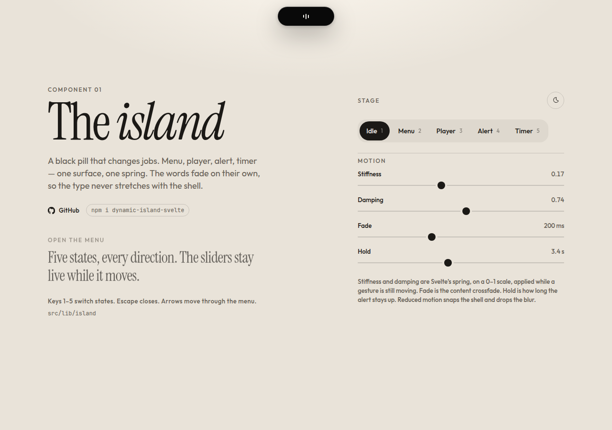

# dynamic-island-svelte

A Dynamic Island-style surface for Svelte 5. One black pill morphs between a resting mark, a menu, a player, an alert, and a counter. The shell is a single spring on width, height, and corner radius. Each state is a snippet you write, already laid out at its destination size, so the type fades instead of stretching.

**Live demo:** [dynamic-island-svelte.vercel.app](https://dynamic-island-svelte.vercel.app)



## Install

```bash
npm install dynamic-island-svelte
```

Peer dependency: `svelte` ^5. The shell’s CSS ships inside the component.

## Usage

```svelte
<script lang="ts">
	import { Island, type IslandStateId } from 'dynamic-island-svelte';

	let phase = $state<IslandStateId>('idle');
</script>

<Island
	state={phase}
	stiffness={0.17}
	damping={0.74}
	fade={200}
	notificationDuration={3400}
	oncollapse={() => (phase = 'idle')}
>
	{#snippet idle()}
		<button type="button" onclick={() => (phase = 'navigation')}>Open</button>
	{/snippet}

	{#snippet navigation()}
		<nav aria-label="Primary">
			<button type="button" onclick={() => (phase = 'idle')}>Close</button>
		</nav>
	{/snippet}

	{#snippet music()}
		<p>Now playing</p>
	{/snippet}

	{#snippet notification()}
		<p>Saved</p>
	{/snippet}

	{#snippet timer()}
		<p>00:00</p>
	{/snippet}
</Island>
```

Keep the variable you pass out of the name `state` — a local called `state` collides with the `$state` rune.

`RollingDigits` is the counter on its own.

```svelte
<script lang="ts">
	import { RollingDigits } from 'dynamic-island-svelte';

	let ones = $state(0);
</script>

<RollingDigits value={ones} stiffness={0.17} damping={0.74} />
```

## Props

### `Island`

| Prop | Default | |
| --- | --- | --- |
| `state` | — | `'idle' \| 'navigation' \| 'music' \| 'notification' \| 'timer'` |
| `stiffness` | `0.17` | Svelte spring stiffness, clamped to `0–1`. Higher is faster. |
| `damping` | `0.74` | Svelte spring damping, clamped to `0–1`. Lower overshoots. |
| `fade` | `200` | Content crossfade, in milliseconds. Exit is shorter; enter waits a beat. |
| `notificationDuration` | `3400` | Milliseconds before `oncollapse` when `state` is `'notification'`. |
| `sizes` | built in | Partial override of `{ width, height, radius }` per state. |
| `label` | `'Island'` | Accessible name of the island region. |
| `oncollapse` | — | Escape, a press outside, or the end of an alert. Ignored when another handler already called `preventDefault()`. |
| `idle`, `navigation`, `music`, `notification`, `timer` | — | Snippets. A missing snippet renders nothing for that state. |

Target sizes shrink to the viewport (`viewport - 36`, never under 220). Idle stays `118 × 40`. Pass `sizes` when a snippet needs a different box. The snippet is centered in a layer of that exact size and clipped by the shell.

```svelte
<Island
	state={phase}
	sizes={{ music: { width: 400, height: 120, radius: 32 } }}
	oncollapse={() => (phase = 'idle')}
/>
```

### `RollingDigits`

| Prop | Default | |
| --- | --- | --- |
| `value` | — | Integer digit `0–9`. Values wrap, and `9 → 0` rolls forward. |
| `stiffness` | `0.17` | Same `0–1` spring as the shell. |
| `damping` | `0.74` | Same `0–1` spring as the shell. |

## Notes

- One `Spring` from `svelte/motion` drives width, height, and radius together, so a gesture can be interrupted. Stiffness and damping are read every frame.
- Content layers sit at the **target** size. Opacity, a 4px blur, and an 8px rise run on `fade`.
- `prefers-reduced-motion: reduce` snaps the spring and drops the blur and the rise. An alert still closes on its timer.
- Outside presses call `oncollapse`. Anything marked `data-island-keep` does not.
- Very low damping with high stiffness can overshoot the content for a moment. That is the spring.
- The shell animates `width` and `height`. It is one layout write per frame, not a transform-only animation.

## Development

Requires Node `>=22.17`.

```bash
npm install
npm run dev
```

The demo serves at [http://127.0.0.1:4731](http://127.0.0.1:4731). `npm run build` builds the demo site. `npm run package` writes the library to `dist/` and runs publint.

In this repo the demo imports the component through `#lib`. Published apps import `dynamic-island-svelte`.

## License

MIT © Emil Majer
